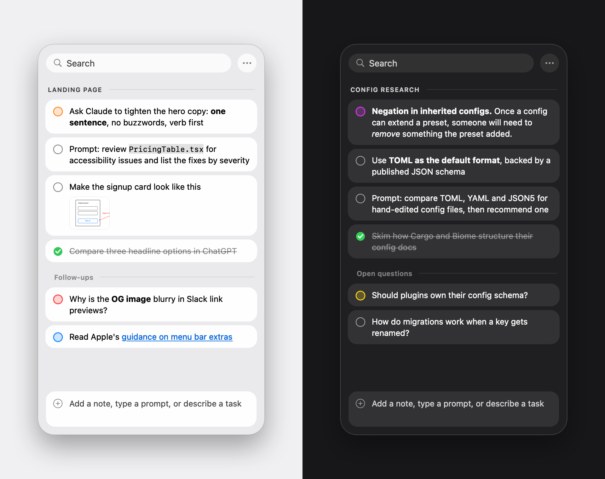

<p align="center">
  
</p>

<h1 align="center">Stash</h1>

<p align="center">
  A tiny Mac app for keeping the things you find while working with AI:<br>
  answers worth saving, links, and the prompts you want to try next.
</p>

<p align="center">
  
</p>

You're deep in a conversation with Claude or ChatGPT and think *"I'll need this later"*, but you don't want to stop. Select the text, **tap Shift twice**, and it's in Stash. Stash sits in the menu bar, keeps everything in one Markdown file on your Mac, and never touches the network.

Stash is a personal re-creation of [Copper](https://shadcn.com/copper) by [shadcn](https://x.com/shadcn), built from its public demos. It isn't affiliated with Copper. If you like the idea, go buy the real thing.

## Features

- **Capture from anywhere.** Select text in any app and double-tap Shift. Formatting copied from Claude, ChatGPT or Chrome (bold, italics, code and links) comes along as Markdown.
- **Sections.** Type `# Name` in the composer to start a section, or `## Name` for a subsection. New notes and captures go to the active section. Press ⌘K to switch, or choose "All Sections".
- **Prompt queue.** Type the prompts you want to try next, copy one with ⌘C, and tick it off. Copy several as a numbered list with ⇧⌘C.
- **Attachments.** Paste or drop files and images, or use ⊕ to attach files or capture a screenshot. Copying a note copies its files too, so screenshots paste straight into your next prompt.
- **Drawing editor.** Press ⌘ + Shift + Shift from any app to sketch with a pen, shapes, arrows and text. Save the drawing to Stash, or copy it into a prompt.
- **Color tags, inline editing, merge, drag to reorder, search and undo.**
- **Menu bar app.** No Dock icon unless you want one, optional launch at login, and a "Saved to …" notice so a capture never happens silently.
- **Local and private.** No account, no sync, no analytics, no network access. Your notes are a plain Markdown file you can open in any editor.

## Install

Stash is built from source. You need macOS 14 or later and the Xcode Command Line Tools (`xcode-select --install`); full Xcode isn't required.

```bash
git clone https://github.com/salimabsi/stash.git
cd stash
./scripts/setup-signing.sh   # once: creates a local code-signing certificate
./build.sh install           # builds, copies to /Applications and launches
```

`setup-signing.sh` adds a self-signed certificate called "Stash Local Signing" to your login keychain. Signing every build with it keeps the app's identity stable, so macOS keeps Stash's permissions when you rebuild. The certificate stays on your Mac and isn't marked as trusted.

### Permissions

- **Accessibility** is required. It lets Stash notice the double-tap shortcut and read your selected text. Stash asks for it when it first starts; you can also grant it in System Settings → Privacy & Security → Accessibility.
- **Screen Recording** is only needed for "Capture Screenshot…", and macOS asks the first time you use it.

## Keyboard shortcuts

| Anywhere | |
|---|---|
| Double-tap ⇧ with text selected | Save the selection to the active section |
| Double-tap ⇧ with nothing selected | Open or close Stash |
| ⌘ + double-tap ⇧ | Open the drawing editor |

| In the composer | |
|---|---|
| Return | Add the note (or create the section, for `# Name`) |
| ⌥Return | Start a new line |
| ↑ when empty | Move into the list |

| On selected notes | |
|---|---|
| Space | Mark done |
| Return | Edit inline (⇧Return adds a line, Esc cancels) |
| ⌘Return | Edit in a separate window |
| ⌘C / ⇧⌘C | Copy / copy as a numbered list |
| ⇧⌘M | Merge |
| ← / → | Collapse or expand a long note |
| ⌫ | Delete |
| ⌘Z | Undo |
| Double-click a thumbnail | Preview it with Quick Look |

| Window | |
|---|---|
| ⌘K | Switch section |
| ⌘F | Search |
| Esc | Clear the search, or close Stash |

The capture key can be changed to Option, Control or Command in Settings, under the ••• menu.

## Your notes

Everything is stored in `~/Library/Application Support/Stash/stash.md`, with attachments copied into an `attachments` folder next to it. ••• → Reveal Notes in Finder shows the file. You can edit it by hand; Stash reloads it the next time the window opens.

```markdown
# Landing page
- [ ] Ask Claude to tighten the hero copy: **one sentence** <!-- orange -->
- [ ] Make the signup card look like this
  
- [x] Compare three headline options in ChatGPT

## Follow-ups
- [ ] Why is the OG image blurry in Slack link previews? <!-- red -->
```

`#` starts a section and `##` a subsection. Each note is a checklist item; lines indented by two spaces continue it. A trailing `<!-- color -->` is its tag, and `` lines are its attachments.

### How capture works

In native Mac apps, Stash reads the selection through the macOS Accessibility API. Chrome and Electron apps (Claude, ChatGPT, Cursor, Slack) only expose plain text that way, so Stash briefly copies the selection to get its formatting, then puts your previous clipboard contents back.

## Development

| Path | What it is |
|---|---|
| `Sources/Stash/` | The app: AppKit, no dependencies |
| `build.sh` | Builds the `.app` bundle; `./build.sh install` also installs and launches it |
| `scripts/setup-signing.sh` | One-time local signing certificate |
| `scripts/make-icon.swift` | Draws the app icon and builds `Resources/AppIcon.icns` |
| `scripts/make-screenshots.sh` | Renders `docs/screenshot.png` offscreen from sample notes |

Set `STASH_DATA_DIR` to run Stash against a different folder, for example to experiment without touching your real notes:

```bash
STASH_DATA_DIR=/tmp/stash-sandbox build/Stash.app/Contents/MacOS/Stash
```

Quit the installed copy first, or both will respond to the shortcut.
